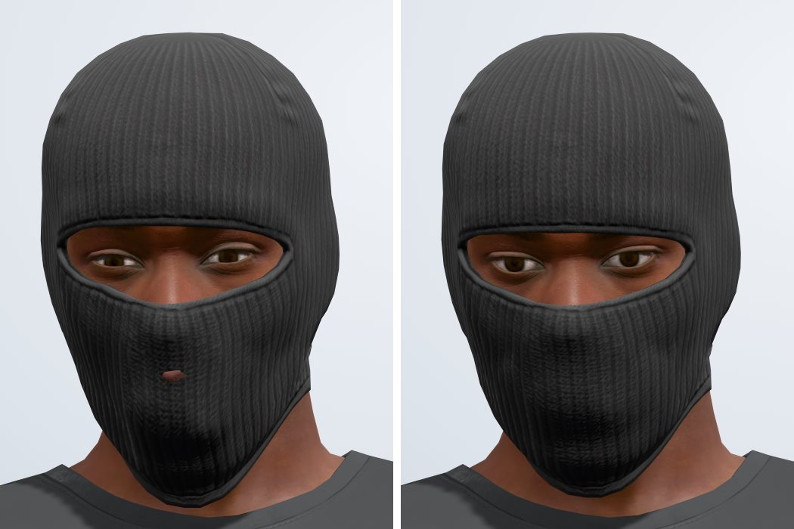

# Balaclava lip in Unrivaled Master (22 Nov 2026)

PR #71's checklist step 5 found a known issue. In Chinals mode, at Unrivaled Master's surprise peak (3.2 s), a sliver of lip
shows through Balaclava Cotton Black. Here we look for the cause and for a faithful fix: one based on the game's own data,
with no hand-tuned offset. Branch `claude/chinals-balaclava-lip-2026-11-22`.

## Result

**The game's own data causes the clip, so no fix built from the game's data exists. This PR changes no app code.**

While this was being investigated, PR #71 reached the same diagnosis and merged **FaceContact** (`fdfc3dd`, main
`abfa045`), which hides the sliver in the viewer. FaceContact is a viewer-side contact, not game data (see "On main now"
below). This PR leaves it as it is. Whether to keep it is the owner's choice.

Measured without FaceContact (main d31db11):

- It is the **upper** lip's centre, not the lower lip. About nine vertices of the upper-lip centre, driven by
  `FACIAL_C_LipUpper1/2`, end up at most 0.9 mm outside the knit.
- The pout is not the trigger; an open jaw is. Face_JawOpen alone does it (0.95 mm), and so does Face_Surprise (which
  opens the jaw) together with Face_BlueSteel. Surprise alone and BlueSteel alone stay inside.
- It is not specific to Chinals. The global emote Carrot Crusher at 1.47 s (Face_JawOpen 0.8) shows the same sliver at
  0.90 mm, although its carrot covers the mouth at that moment. Evil Jester's peak comes within 0.06 to 0.19 mm.



## Mechanism

A balaclava is a head-wrapped part. Its cloth proxy, a 103-vertex subset of the head's 439-vertex `_Wraps` cage, follows
the face, and the knit follows the proxy.

- **The proxy has no upper-lip vertex.** Over the mouth it has just two triangles. Each runs from the nose tip and one
  nostril straight down to the lower-lip centre: proxy vertex 68, skinned to `FACIAL_C_LipLower1/2`. A knit vertex
  over the upper lip is bound 62 % to that lower-lip vertex (`trace-vertex.mjs`).
- **When the jaw opens, the knit over the upper lip sinks inward.** Under Face_JawOpen with the balaclava's face mask
  (lips and jaw at 0.5), the lower-lip proxy vertex drops about 13 mm. The knit over the upper lip then moves 11.6 mm
  inward along its normal, while the upper lip moves only 2.3 mm.
- **The upper lip passes through.** At rest, the upper-lip centre sits 1.5 to 3.8 mm inside the knit. The straight
  nose-to-lower-lip chord then passes behind the protruding upper lip, and the lip comes through.
- **Without the cage following, the gap holds.** Left on the still cage, the knit keeps a 2.2 mm gap over the upper lip
  in the same pose.

## Checked against the game

Everything was read offline from the installed game's paks with `scripts/anim-export` (read-only; nothing touched a
running game). `check-cloth-data.mjs` reproduces items 1 to 3 below; its output is `cloth-data.json`.

| What | The game's data | The viewer |
| --- | --- | --- |
| 1. What moves the proxy | Embark's cloth config: `SimulationType None`, pre-simulation deformer `LinearSkinning`, post-simulation `SoftenNormals`. The proxy's own skin is `PhysicalMeshData.BoneData`. | The face cage's skin, whose weights match the proxy's own within L1 0.035 on every vertex. |
| 2. The mouth | No proxy vertex follows an upper-lip bone. The lower-lip centre's triangles reach the nose tip and nostrils. | Same proxy (head-wraps.json). |
| 3. Render vertex to proxy | `ClothMappingDataLODs` (new `.cloth.json` output of `AnimExport mesh`): nearest triangle by closest point, then the point projected onto it **along the proxy's vertex normals** (normalised sums of unit face normals, smallest-|d| root). Reproduces all 1,081 vertices to 2 µm. | Same triangles except 56 equal-distance ties. Stores the closest point plus a rigid offset in the triangle's frame instead. |
| 4. Face mask | `BWA_FaceJoints_FaceMask`: every jaw and lip bone at 0.5, eyes at 1. All 289 driven bones are listed. | Same, applied per bone in local space. |
| 5. Morphs, hiding, material | `shrink_balaclava_to_face` is switched on only by helmets and the ballistic mask. The item hides facial hair, brows and earrings, not the head. The knit is the shared layered character material. | Same; nothing there would cover the lip. |

**The binding difference (row 3) is not the cause.** `engine-binding-experiment.patch` makes `HeadWrap.ts` bind and
evaluate exactly as the engine does. With it, the sliver stays, slightly larger: 0.99 mm at 3.2 s, 1.03 mm in Carrot
Crusher, 1.10 mm under JawOpen. The other variants in `formula-ab.mjs` give 0.87 to 1.37 mm: the rigid frame,
interpolated normals recomputed from the moved cage, and normals carried by the cage skinning. The runtime change was
therefore reverted. The patch stays as a record. It would change every head-wrapped part (beards, scarves, balaclavas)
on every face that is not HeadMaster, so adopting it would need its own review.

**What cannot be read:** Embark's `LinearSkinning` and `SoftenNormals` deformers are engine code, not data. They decide
which normals the knit's 5 mm offset follows. Across the variants above, that choice moves the result by about ±0.3 mm,
not enough to close a 0.9 mm sliver, but the game's exact figure is not knowable from the paks.

## On main now: FaceContact (PR #71)

Hiding the sliver takes something the game does not author. PR #71's `fdfc3dd` added such a thing: **FaceContact**, in
`src/rig/FaceWrap.ts`.

- **How it works:** each head vertex a wrapped part covers is bound to the part triangle above it. While the face moves,
  a head vertex that comes closer than min(its rest gap, 1 mm) pushes that triangle's corners out along their normals.
  It only ever pushes the part out, and a still face changes nothing.
- **What it is:** a viewer-side contact. It is neither a fixed offset nor part of the game's data.
- **Measured on production builds** (`prod-steps.mjs`), upper-lip vertices outside the knit:

| Pose | main d31db11 (before #71) | this branch with main abfa045 (FaceContact) |
| --- | --- | --- |
| Unrivaled Master 3.2 s | 9 vertices, at most 0.87 mm | none (nearest 0.62 mm inside) |
| Carrot Crusher 1.47 s (global) | 8, at most 0.90 mm | none (0.39 mm inside) |
| Goblin Horn 0.3 s (global pout) | none (0.74 mm inside) | none (0.92 mm inside) |
| Facial animation off | none (1.78 mm inside) | none (1.78 mm inside) |

**For the owner to decide:**
- **Keep FaceContact:** no lip shows through, but the viewer then shows less than the game most likely does here.
- **Remove it:** the about-1 mm sliver returns at the mouth-open peaks of two Chinals clips and of global Carrot Crusher,
  where the carrot hides it. That would be faithful to the game's proxy.

Two independent analyses, #71's and this one, conclude that the game most likely shows the sliver.

## Files

- `check-cloth-data.mjs`: offline check of a head-wrapped part's cloth data (rows 1 to 3 above). Inputs are the dumps
  below and the published HeadMaster cage skin (`faces-2/wraps/SK_Head_HeadMaster_Base_Wraps.json` on fd946744).
- `measure-lip.mjs`, `trace-vertex.mjs`, `formula-ab.mjs`, `balaclava-pout.mjs`: in-page probes on a dev server
  (usage in each header).
- `prod-steps.mjs`: the production-build run of `functional-checklist.md`. Results: `prod-steps.json` for this branch
  with main abfa045 merged in (FaceContact), and `prod-steps-d31db11.json` for main d31db11 (before it).
- `engine-binding-experiment.patch`: the engine-exact binding, measured and reverted.
- `scripts/anim-export/MeshDump.cs`: `AnimExport mesh` also writes `<mesh>.cloth.json` (each LOD0 section's
  `ClothMappingDataLODs[0]`) when the mesh has cloth. Mesh files are unchanged.

Dumps used, all gitignored under `scripts/generated/balaclava-lip/`. Run from the worktree root in Git Bash, after
`dotnet build -c Release` in `scripts/anim-export`. If FModel's temp copy of `CUE4Parse-Natives.dll` is gone, pass
`-p:NativesDll=<a copy>`.

```bash
dotnet scripts/anim-export/bin/Release/net10.0/AnimExport.dll mesh "C:/Program Files (x86)/Steam/steamapps/common/The Finals/Discovery/Content/Paks" "E:/Coding/the-finals-outfit/scripts/generated/shader-probe/tools/5.7.4-1432394+discovery_12.00.x-Discovery.usmap" "<oodle-data-shared.dll>" scripts/generated/balaclava-lip/cloth-dump "Balaclava/SK_Streetwear_Balaclava_M\.uasset$" "$APPDATA/FModel/AppSettings.json"
dotnet scripts/anim-export/bin/Release/net10.0/AnimExport.dll json  (same arguments, output scripts/generated/balaclava-lip/json-dump)
```
