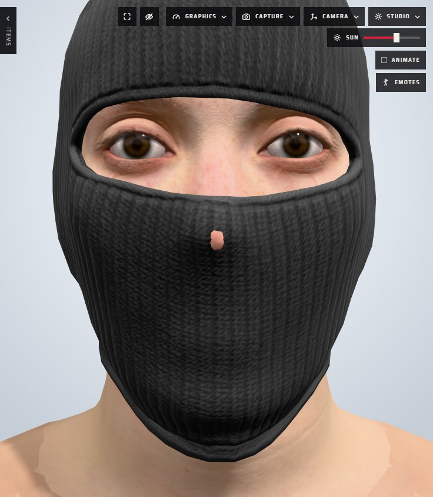
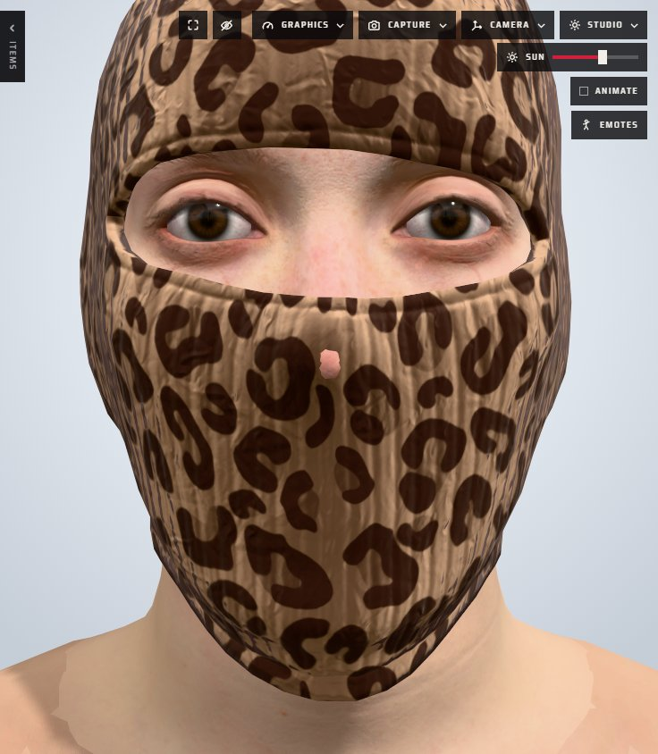
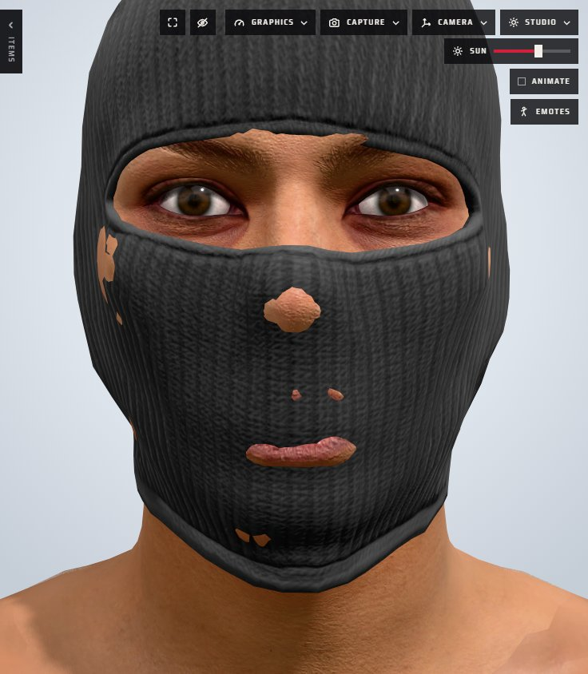
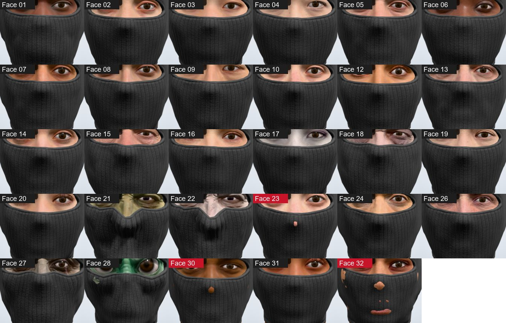
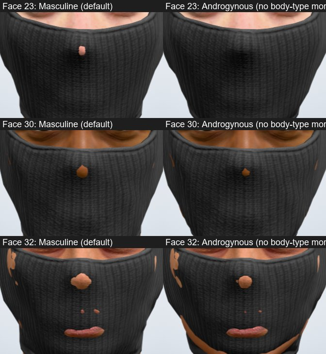

# Balaclava nose poke at idle (26 Nov 2026)

The visual-diff route audit (PR #99, `_docs/visual-diff-route-audit-2026-11-25/`) saw the nose tip come through Balaclava
Cotton Black and Balaclava Leopard on the site's renderer (the reconstructed route) at the idle pose. This record looks
for the cause and for a faithful fix. Branch `claude/balaclava-nose-2026-11-26`.

## Result

**The live site shows it. The viewer is reproducing the game's own data, so no fix built from the game's data exists.
This PR changes no app code.** It records the cause, the evidence and the options.

- **Live, not just local.** The production site (main `8464b96`, the hosts in `deploy.yml`) shows the poke. So does a
  dev server on those hosts. The local index adds nothing here: `head-wraps.json` and the balaclava mesh are
  byte-identical on disk and on the live reconstruction host `dfe1d5e8`.
- **It depends on the face.** 3 of the 29 reconstructed faces show it at idle: Faces 23, 30 and 32. Face 32 is the
  worst: nose, nostrils, lips, the cheek edges and the brow. Faces 24 and 28 show a speck elsewhere (brow and cheek).
  The other 24 are closed.
- **The audit's face was `head-face-23-base`, not `cns-base`.** `verify-render2.mjs` equips Face 23 for every head
  slot (`BASE_HEAD`). In passing: with `cns-base` the reconstructed route refuses the balaclava on a dev server ("A
  head-wrapped part requires a preserved source head") and draws none.
- **The icons don't test these faces.** Item icons use a featureless mannequin head. The Blank Face, which wraps on
  HeadMaster's own cage, shows the knit closed like the icon (`checklist-4-5.jpg`).

| Live site, Face 23, Cotton Black | Live site, Face 23, Leopard | Live site, Face 32, Cotton Black |
| --- | --- | --- |
|  |  |  |

All 29 faces at idle, Masculine (the viewer's default body type), dev server on the live hosts. Red labels poke:



## Cause

Two things add up, and both are the game's own data.

1. **These faces' own wrap cages sit about 2.5 mm inside their noses.** A balaclava follows the worn face's 439-vertex
   `_Wraps` cage (`HeadWrap.ts`). The knit is authored on HeadMaster, where it clears the nose tip by about 1.5 to
   2.5 mm. On HeadMaster, Face 01 and Face 10, the cage's nose vertex (cage vertex 77) sits within 0.25 mm of the head's
   nose tip. On Faces 23, 30 and 32 it sits 2.5 to 2.6 mm behind it, so the nose tip reaches the knit.
2. **The Masculine body type pulls the knit in over the nose.** Masculine has been the viewer's default since 21 Oct
   (`BodyTypePreview.ts`). It applies `medium_male` to every mesh that carries it. The balaclava's own `medium_male`
   moves the knit over the nose inward by up to 0.95 mm (0.44 mm on average). The head's and the cage's `medium_male`
   are zero over the face; they are neck morphs. On Face 23 this decides it: the knit clears by 0.24 mm without the
   morph and is 0.68 mm through with it. Faces 30 and 32 poke through without it too.

Measured two ways, which agree:
- `knit-clearance.py` uses only the game's data: a fresh read-only extraction from the installed build (17 Nov patch
  mapping `f36b7c4f`), wrapped the way `HeadWrap.ts` wraps. Output: `knit-clearance.txt`.
- `nose-probe.mjs` measures in the running viewer, on a dev server against the live hosts. Output:
  `nose-probe-results.txt`.

The figures are the nearest knit crossing in front of the nose-tip region; a negative figure means the skin is in front
of the knit.

| Face | Cage nose behind head nose | Knit, no body type | Knit, Masculine | In the viewer, Masculine |
| --- | --- | --- | --- | --- |
| HeadMaster (Blank Face) | 0.15 mm | +2.44 mm | +1.54 mm | closed (live site, by eye) |
| Face 01 | 0.07 mm | +1.57 mm | +1.91 mm | +1.91 mm |
| Face 10 | 0.22 mm | +1.32 mm | +0.40 mm | +0.46 mm |
| Face 23 | **2.62 mm** | +0.24 mm | **−0.68 mm** | **−0.67 mm** (Androgynous +0.25 mm) |
| Face 30 | **2.63 mm** | −0.45 mm | **−1.33 mm** | **−1.50 mm** |
| Face 32 | **2.50 mm** | −1.46 mm | **−2.28 mm** | **−2.34 mm** |

The viewer's own Androgynous body type has no Medium morph, so it shows the morph's share without a code change. It
closes Face 23, shrinks Face 30's poke, and leaves Face 32 poking through:



## Ruled out

| Candidate | Finding |
| --- | --- |
| `HeadWrap.ts` binding (closest point plus a rigid frame) | PR #75's `engine-binding-experiment.patch`, the engine-exact cloth binding, still pokes: Face 23 −0.41, Face 30 −1.36, Face 32 −1.86 mm. Reverted. |
| FaceContact (PR #71) | It acts only while the face animates, and a still face changes nothing. The figures above are from `pose=a` with no facial animation. Kept, as the owner decided on 22 Nov. |
| DefaultFace morphs | The balaclava activates only `default_ears`, both in the stored definition and in today's build. The head and the cage both take it, and it is zero at the nose. Nothing activates `default_nose`. |
| Body-type morphs on the head and the cage | `medium_male` is zero over the face on Faces 23 and 32's heads and cages, and on HeadMaster's cage. |
| Head-socket frames | Not used by a skinned head-wrapped part. |
| S12 mesh refresh, Light bulk, local applies | The balaclava mesh is the original `reconstructed-attached-b1p1-v1` GLB (same sha256 locally and live). Today's build's cages, heads and balaclava equal the published ones to 0.001 mm. |
| Stale item definitions | Today's build's definitions of both balaclavas are identical to the stored ones. The faces differ only by the new `FaceRigPoseAsset` field. |
| The face material's pixel depth offset | `M_Face` does write a depth offset (`SV_DepthLessEqual`), which the viewer leaves out. It is gated by `T_Face_NeckFade`, which is 1.0 on 80 % of texels and gives no offset there: it blends the neck seam, not the face. |
| The cosmetics route (`reconstructed=0`) not poking | That route draws a static, pre-fitted GLB, not a per-face wrap, so its closed nose says nothing about the game. |

## Does the game show it?

That can't be read from the paks. The game's cloth configs suggest it does, but the deformer code isn't in the paks, and
no in-game capture of these faces with this balaclava was available.

The configs: the cages and the balaclava carry `EmbarkClothConfig` with `bApplyAvaliableMorphTargetsAsDefault` true,
pre-simulation `LinearSkinning`, post-simulation `SoftenNormals` and `SimulationType None`. That says morphs reach the
cloth, which is how the viewer composes them. On that reading the game shows the same poke on Faces 23, 30 and 32 with
Masculine.

## Options (the owner's call)

- **A. Keep it (faithful to the data).** Record it as known: those three faces poke through this balaclava. No change.
- **B. A rest contact (viewer-side).** Extend FaceContact so that a head vertex already through the knit at rest pushes
  the knit out to a small clearance, for example 0.5 mm.
  - It hides the poke on all three faces, at idle and in emotes.
  - It departs from the game's data: by about 1 mm on Face 23, about 2 mm on Face 30, and several millimetres over Face
    32's lips and cheeks.
  - It is the same kind of decision as FaceContact on 22 Nov, where the owner chose "Fix it first".
  - It needs a new binding: FaceContact only binds head vertices that lie under a part triangle, and these lie outside
    it. It also needs its own PR, with checks on emotes and the other head-wrapped parts.
- **C. Not recommended: drop the knit's own body-type morph on head-wrapped parts.** It closes only Face 23 (+0.24 mm),
  not Faces 30 or 32. The cloth config also suggests the game does apply those morphs.

## A separate gap found on the way (not this defect)

`head-wraps.json` publishes only the cages' fitting morphs. The filter is `build-head-wraps.py`'s `FITTING_MORPH`,
written on 12 Oct, when body types were off.
- The cages also carry the body-type morphs: `medium_male`, `medium_female`, `light_*` and `heavy_*`, up to 24 mm at
  the neck.
- `CharacterRig.setBodyTypePreview` expects "a head-wrapped part's cage takes it too when the cage carries it".
- Since Masculine became the default on 21 Oct, no cage has taken it.

Over the face it is zero, so it plays no part in the nose. It would move the lower edge of balaclavas, beards and
scarves at the jaw and neck. Fixing it needs a rebuild of `head-wraps.json` and its own review. It is only flagged here.

## Reproduce

All of these read only; nothing is written to `public/models` or the live hosts.

- **Offline, game data only.** Run the ShaderProbe `assets` mode in the root checkout, as `s12-definition-drift.py`
  does but in `assets` mode, with the 17 Nov patched mapping. Request:
  - `SK_Head_<face>_Base` and `SK_Head_<face>_Base_Wraps` for HeadMaster and Faces 01, 10, 23, 30 and 32;
  - `SK_Streetwear_Balaclava_M`.

  Then:

  ```bash
  # Git Bash, from the root checkout
  python -I _docs/balaclava-nose-2026-11-26/knit-clearance.py <extract dir> [<extract dir>] --headwraps public/models/reconstructed-assemblies-v1/head-wraps.json
  ```

- **In the viewer.** Start a dev server with the `deploy.yml` hosts in `.env.local` (the `VITE_*` values). Then:

  ```bash
  # Git Bash, from this worktree
  node _docs/balaclava-nose-2026-11-26/nose-probe.mjs "$PWD" http://127.0.0.1:5217/the-finals-outfit <out dir> _docs/balaclava-nose-2026-11-26/nose-probe-shots.json
  ```

- **On the live site.**

  ```bash
  # Git Bash, from this worktree
  node _docs/balaclava-nose-2026-11-26/prod-shot.mjs "$PWD" https://chronohaxx.github.io/the-finals-outfit <out dir> _docs/balaclava-nose-2026-11-26/checklist-shots.json
  ```

  Its results: `checklist-run.json`.

The agent-run checklist is in `functional-checklist.md`.
