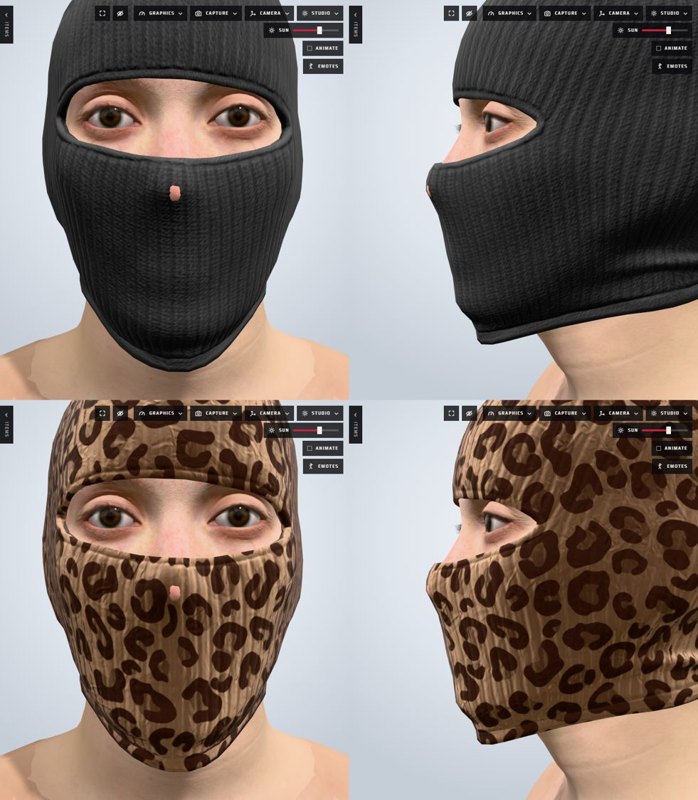
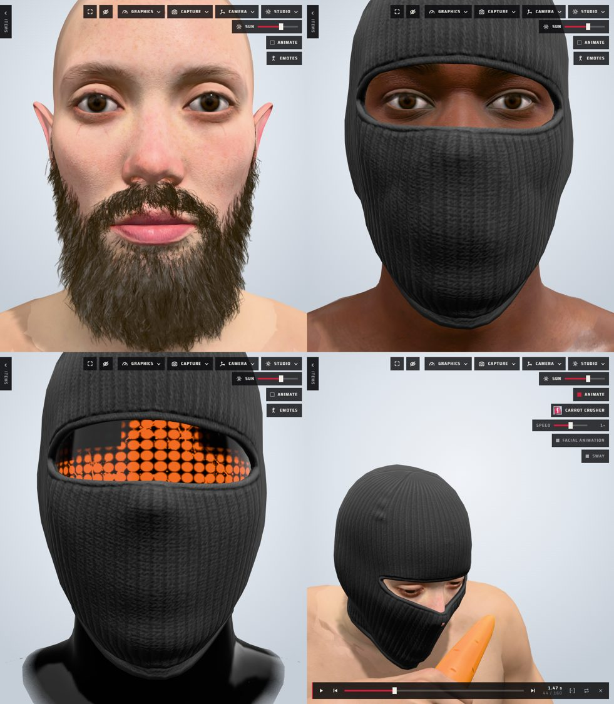

# Guided functional review: balaclava nose finding

## What you are checking

This PR changes no app behaviour. It records why the nose tip comes through Balaclava Cotton Black and Balaclava
Leopard on Faces 23, 30 and 32 at idle: those faces' own wrap cages, plus the Masculine body-type morph on the knit
(README.md). The checks confirm that the live site behaves as the README says, and that nearby head items are as before.

- PR: this branch's PR (originating issue: the PR #99 route audit, `_docs/visual-diff-route-audit-2026-11-25/`)
- Test this revision: branch `claude/balaclava-nose-2026-11-26`. Its app code equals main `8464b96`, which is what
  GitHub Pages serves, with the hosts in `deploy.yml`.
- Open: the live site, https://chronohaxx.github.io/the-finals-outfit/, through the links below.
- Prerequisites: none.
- Approximate hands-on time: 5 minutes.
- Agent checks: PASS for steps 1-5 on 26 Nov 2026, as the README describes them. Evidence: `checklist-run.json`,
  `checklist-1-3.jpg` and `checklist-4-5.jpg`, made by `prod-shot.mjs` from `checklist-shots.json`.
- User checks: waived by the owner for all PRs (22 Nov). The agent ran them; agent results do not tick the boxes.

## Get it running

Open the links in a desktop browser. The `view=` part puts the camera about 40 cm from the face. To repeat the agent
run (Git Bash, in this worktree):

```bash
node _docs/balaclava-nose-2026-11-26/prod-shot.mjs "$PWD" https://chronohaxx.github.io/the-finals-outfit /tmp/balaclava-check _docs/balaclava-nose-2026-11-26/checklist-shots.json
```

Nothing is saved to the site.

## Try it yourself

- [ ] **1. Start:** open
  [Face 23 + Cotton Black, front](https://chronohaxx.github.io/the-finals-outfit/?outfit=1.eyJzbG90cyI6eyJmYWNlIjoiaGVhZC1mYWNlLTIzLWJhc2UiLCJmYWNld2VhciI6InN0cmVldHdlYXItYmFsYWNsYXZhLWNvdHRvbi1ibGFjayJ9fQ&view=0_1.700_0.420_0_1.690_0).
  Expected: the viewer loads with no error, and the balaclava is on the head. A small skin-coloured dot (the nose tip)
  shows through the knit below the eye opening. That is the recorded finding, not a new defect.
- [ ] **2. Side view:** open
  [the same, from the side](https://chronohaxx.github.io/the-finals-outfit/?outfit=1.eyJzbG90cyI6eyJmYWNlIjoiaGVhZC1mYWNlLTIzLWJhc2UiLCJmYWNld2VhciI6InN0cmVldHdlYXItYmFsYWNsYXZhLWNvdHRvbi1ibGFjayJ9fQ&view=0.400_1.700_0.160_0_1.690_0.050).
  Expected: the knit follows the profile from brow to chin. The nose tip shows only as a pinpoint at the front edge.
- [ ] **3. Leopard:** open
  [Face 23 + Leopard, front](https://chronohaxx.github.io/the-finals-outfit/?outfit=1.eyJzbG90cyI6eyJmYWNlIjoiaGVhZC1mYWNlLTIzLWJhc2UiLCJmYWNld2VhciI6InN0cmVldHdlYXItYmFsYWNsYXZhLWxlb3BhcmQifX0&view=0_1.700_0.420_0_1.690_0)
  and
  [from the side](https://chronohaxx.github.io/the-finals-outfit/?outfit=1.eyJzbG90cyI6eyJmYWNlIjoiaGVhZC1mYWNlLTIzLWJhc2UiLCJmYWNld2VhciI6InN0cmVldHdlYXItYmFsYWNsYXZhLWxlb3BhcmQifX0&view=0.400_1.700_0.160_0_1.690_0.050).
  Expected: leopard spots on tan knit, and the same nose-tip dot at the front.
- [ ] **4. Nearby face items:** open each of these:
  - [Face 23 + Full Beard](https://chronohaxx.github.io/the-finals-outfit/?outfit=1.eyJzbG90cyI6eyJmYWNlIjoiaGVhZC1mYWNlLTIzLWJhc2UiLCJmYWNpYWxIYWlyIjoiZmFjaWFsaGFpcnMtYmVhcmRmdWxsLWJsYWNrIn19&view=0_1.700_0.420_0_1.690_0):
    the beard sits on the jaw and nothing pokes through it.
  - [Face 01 + Cotton Black](https://chronohaxx.github.io/the-finals-outfit/?outfit=1.eyJzbG90cyI6eyJmYWNlIjoiaGVhZC1mYWNlLTAxLWJhc2UiLCJmYWNld2VhciI6InN0cmVldHdlYXItYmFsYWNsYXZhLWNvdHRvbi1ibGFjayJ9fQ&view=0_1.700_0.420_0_1.690_0):
    the knit is closed over the nose.
  - [Blank Face + Cotton Black](https://chronohaxx.github.io/the-finals-outfit/?outfit=1.eyJzbG90cyI6eyJmYWNlIjoiaGVhZC1ibGFua2ZhY2UiLCJmYWNld2VhciI6InN0cmVldHdlYXItYmFsYWNsYXZhLWNvdHRvbi1ibGFjayJ9fQ&view=0_1.700_0.420_0_1.690_0):
    the knit is closed over the nose, like the item icon. This face wraps on HeadMaster's own cage.
- [ ] **5. An emote with jaw movement:** open
  [Face 23 + Cotton Black, Carrot Crusher held at 1.47 s](https://chronohaxx.github.io/the-finals-outfit/?outfit=1.eyJzbG90cyI6eyJmYWNlIjoiaGVhZC1mYWNlLTIzLWJhc2UiLCJmYWNld2VhciI6InN0cmVldHdlYXItYmFsYWNsYXZhLWNvdHRvbi1ibGFjayJ9fQ&view=0.250_1.650_0.900_0_1.600_0&emote=rabbit-carrot&t=1.47&paused=1)
  (Face_JawOpen 0.8). Expected:
  - the clip is paused at 1.47 s;
  - the knit follows the open jaw and stays over the mouth;
  - the carrot is in front of the mouth;
  - only the same nose-tip dot shows through.

If something fails, stop at that step and report its number and what happened. Reply "1-5 pass" (using the actual
step numbers), or for example "3 fails: the leopard spots are missing".

## Recorded result

- Tested revision/build: the live site, GitHub Pages from main `8464b96` with the `deploy.yml` hosts. This branch
  changes no app code.
- Agent run: 26 Nov 2026, headless Chrome at 1280×900. Every page reached `__rigIdle`, with no page or console errors
  (`checklist-run.json`).
  - Step 1 PASS: loads; nose-tip dot as recorded (`checklist-1-3.jpg`, top left).
  - Step 2 PASS: knit follows the profile; a pinpoint at the nose tip (top right).
  - Step 3 PASS: leopard print; the same dot (bottom row).
  - Step 4 PASS: the beard is clean; Face 01 and Blank Face are closed over the nose (`checklist-4-5.jpg`).
  - Step 5 PASS: paused at 1.47 s (64/150), jaw open, knit over the mouth, carrot in front. The nose-tip dot shows at
    the front edge (bottom right).
- User reported at: pending (checks waived for all PRs, 22 Nov).
- Readiness: agent PASS. Merge needs the owner's yes, and the owner's choice among the README's options.




