# Balaclava rest contact (26 Nov 2026)

On some faces the still face comes through Balaclava Cotton Black and Balaclava Leopard at idle. Face 32 is the worst:
nose, nostrils, lips, cheeks and chin. PR #103 (`_docs/balaclava-nose-2026-11-26/`) traced it to the game's own data:
those faces' wrap cages sit about 2.5 mm inside their noses, and the Masculine morph pulls the knit in. This PR hides
it in the viewer. Branch `claude/balaclava-rest-contact-2026-11-26`, off main `842fa6d`.

**This is viewer-side, not game data.** Where the face pokes through, the knit is moved off the shape the game's data
gives it: outwards only, at most 5.84 mm, and only on the 8 faces in the table below. The game's data has no rule
that hides the face there (next section).

## Route: no game rule hides the face, so option B

The faithful route came first: does the game hide the face skin under the balaclava? It does not.

| Where a hide could come from | What the data says |
| --- | --- |
| The two balaclava definitions (`reconstructed-assembly-v2/items/streetwear-balaclava-{cotton-black,leopard}.json`, read from the raw `.uasset`) | No `HideParts`, no `TagOverrides`, no logic modules. `ActivatesTags`: `PushHair.hat_covers_head`, `DefaultFace.default_ears`, `HideMesh.FacialHairCovered`, `HideMesh.BrowsCovered`, `HideMesh.EarringsCovered`, `PushHeadwear.grow_tight_headwear`. Those hide facial-hair, brow and earring meshes and push hair and other headwear. None names the head or its skin. |
| Body hide (`M_Skin` `SHOW_INDEX` + UV1 masks) | That is the body material. The face uses `M_Face`, which has no `SHOW_INDEX`. The viewer applies part hides to `M_Skin` sections, which is all the game has. |
| `M_Face` opacity | Only the neck fade (`T_Face_NeckFade`), which blends the neck seam. |
| Head-hide or face-hide flags | The part has `bIsHeadMesh` false and no `OptionalHeadWrapMesh`. `bMaskOutFacialAnimation` only scales facial animation, and FaceAnimator already applies it. |
| Under-layer rules | None on either balaclava. |

So the game draws the face under the knit too. Option B from PR #103 applies: a contact at rest that extends
FaceContact. It is the same kind of decision as the owner's "Fix it first" for the lip on 22 Nov.

## What it does

`FaceWrap.ts` `restContact` runs from `CharacterRig` whenever the worn head or its fitting morphs change: an outfit
commit, a body-type change, or a face removed.

1. **Find the skin that pokes through.** For every vertex of the head's skin sections, follow the skin's own normal
   into the head, up to 6 mm. If the part crosses that line, the vertex is outside the part.
2. **Skip the lining of an opening.** The knit rolls in at the eye opening and at the hem, and runs on inside the head
   by design, up to 10 cm. Skin in the eye opening faces that lining without being under the knit. The game's own wrap
   tells the two apart: lining vertices lie inside the head cage, or face away from it (`HeadWrap.ts` `overHead`).
   A vertex whose normal line meets lining first is left alone. So is one whose crossing faces another way (a fold).
3. **Push out.** The part triangle over each poking vertex is pushed out along its corners' normals until the vertex
   is 0.5 mm inside. It uses FaceContact's least-squares shares. Only those corners move, only outwards, at most 6 mm.
4. **Keep it.** The push is stored per part vertex and added after every wrap, still or moving. FaceContact, which
   acts while the face animates, therefore binds to the pushed knit (`FaceAnimator` keys it by a rest version).

Hair-card parts (beards, moustaches, brows) take none: their cards lie on the skin and the skin between them shows. A
part the face pokes through nowhere is left exactly as before: no push, no re-wrap.

## How far the knit moves (maximum deviation from the game's data)

The largest push of any knit vertex, from `restContactMaxPush` in the running viewer at idle (dev server on the live
hosts). Cotton Black and Leopard share one mesh and give identical numbers.

| Face | Masculine | Androgynous | What came through before |
| --- | --- | --- | --- |
| 15 | 0.76 mm | 1.56 mm | a pinpoint at the nose tip |
| 22 | 1.14 mm | 1.14 mm | a pinpoint beside the nose |
| 23 | 1.50 mm | 0 | the nose tip |
| 24 | 1.70 mm | 1.70 mm | the brow, at the top of the eye opening |
| 26 | 0.75 mm | 0 | a pinpoint at the nose tip |
| 28 | 5.84 mm | 5.84 mm | the brow ridges and a cheek speck (see below) |
| 30 | 2.24 mm | 3.84 mm | the nose tip (Androgynous: also a speck at the side) |
| 32 | 3.74 mm | 5.79 mm | nose, nostrils, lips, cheeks, chin (Androgynous: a band along the jaw too) |
| the other 21 | 0 | 0 | nothing: unchanged |

The other head-wrapped parts, at idle on Masculine (Faces 01, 23, 28, 30 and 32):
- Winter Mouth Scarf: 0.81 to 2.28 mm. The face pokes through it too, out of sight under its folds. From the front it
  looks as before, except that Face 32's chin specks under the lower fold shrink to a sliver (top row: main):

  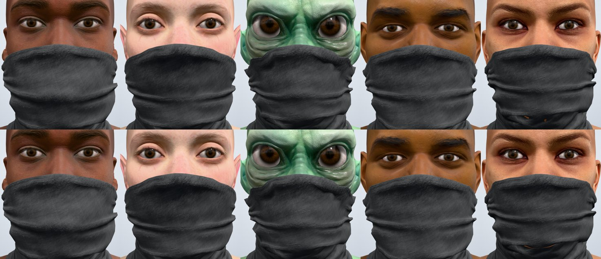
- Cowboy Mouth Scarf and Luchador Face Mask: 0, no change.
- Beards: none (hair cards).

**Face 28 is only partly closed.** It is a creature face whose brow ridges stand out over the eye opening. The cheek
speck and most of the left brow are gone. A patch of the right brow ridge still shows above the opening. There the
knit's rolled rim is itself buried in the brow, and the contact leaves the rim alone by design (2 head vertices stay
through after the push; every other face: 0). Closing it would mean moving the rim of the opening by more than 6 mm.
Top: main; bottom: this branch (the overlay is the viewer's own UI):

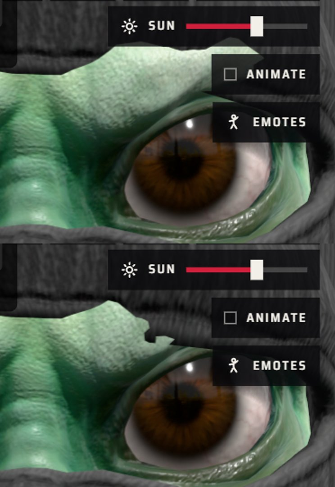

## Verification

Agent-run, 26 Nov 2026, headless Chrome at 1280×900 on dev servers with the live hosts (`deploy.yml`): this branch on
`:5217`, main's code on `:5218`. Every shot reached `__rigIdle` with no page or console errors.

- **All 29 faces × both balaclavas × Masculine and Androgynous at idle** (116 shots). The 21 faces with no push are
  unchanged by construction: no push means no re-wrap. The 8 that change were captured before and after:

  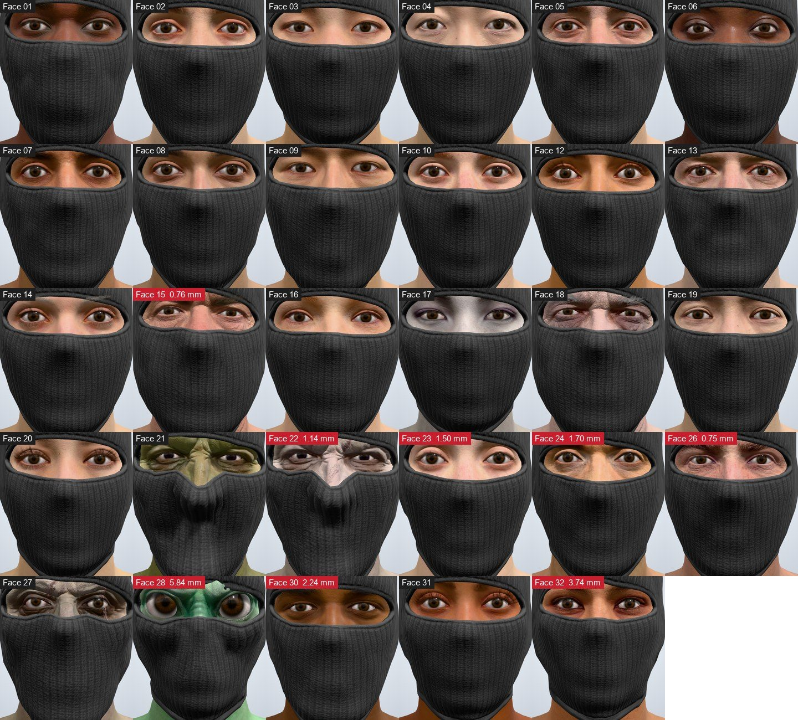

  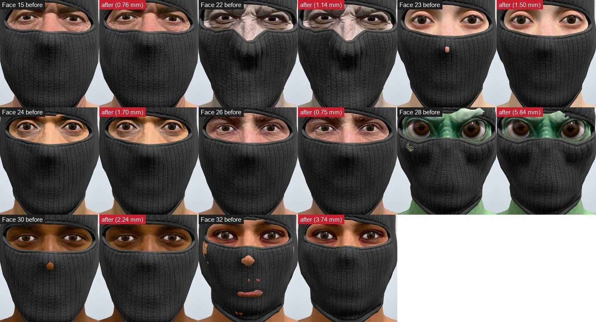

  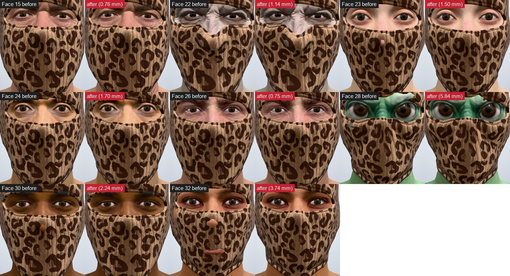

  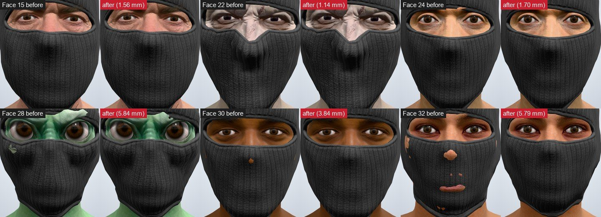

  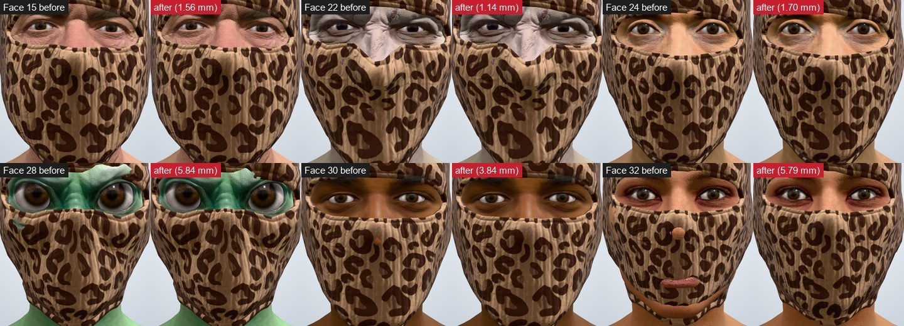

  The full after sheets for the other three combinations are `after-all-faces-{m-leo,a-black,a-leo}.jpg`.

- **Face 32 up close**, Masculine (front, 3/4, below) and Androgynous (front, below, side). Top rows: main; bottom rows:
  this branch. The knit is a little fuller over the nose and lips; the eye opening and the hem are unchanged.

  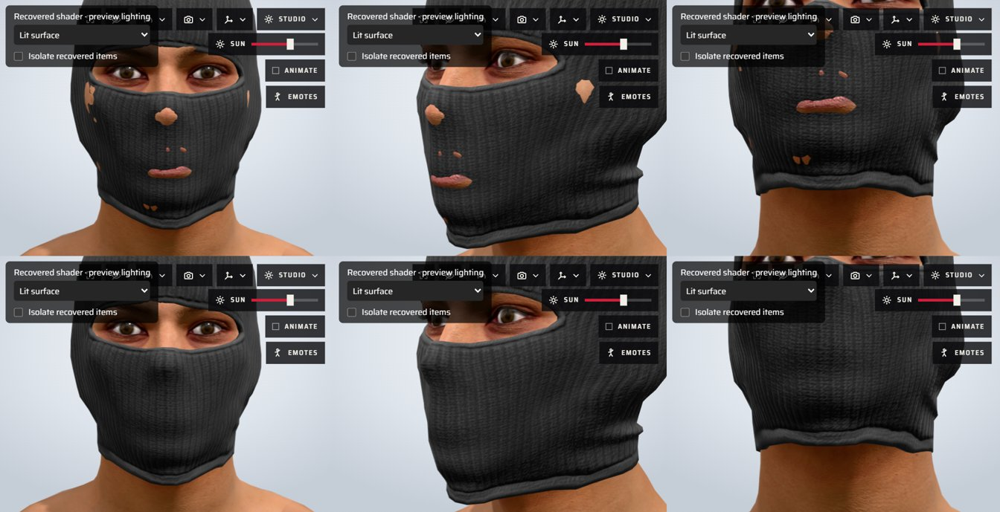

  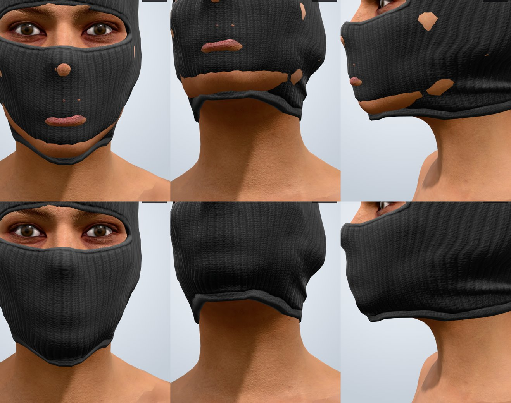

- **Jaw open:** Carrot Crusher held at 1.47 s (`Face_JawOpen` 0.8), Faces 01, 23, 30 and 32, seen from the side the
  carrot does not cover. Main shows Face 32's nose tip and lip through the knit; this branch is closed. FaceContact
  binds to the pushed knit.

  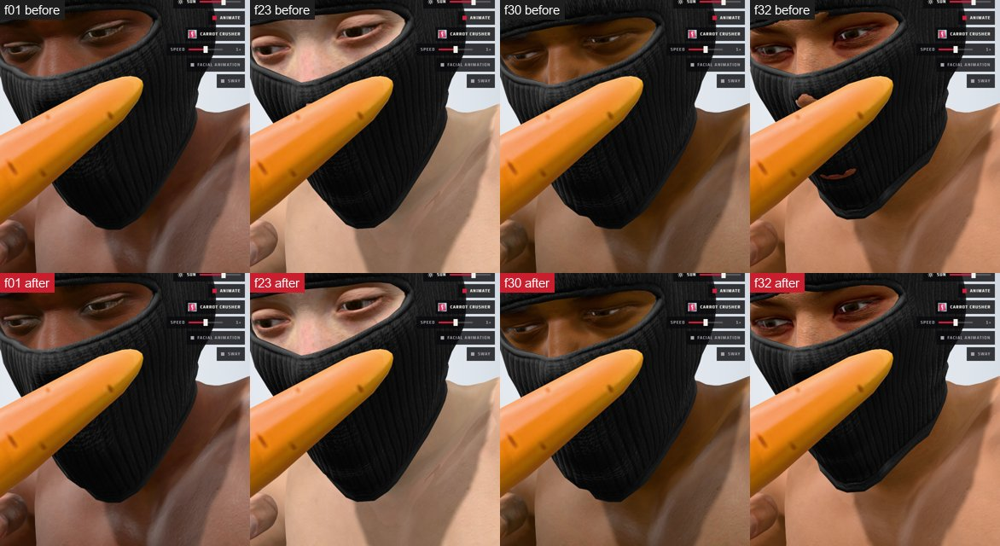

- **Nothing else moved.** Full Beard alone, and Full Beard with Cowboy Mouth Scarf, on Faces 01, 23 and 32: no push,
  and the images match main. Beard + scarf: 126 to 157 differing pixels of 621k, which is idle noise (the scarf hides
  the beard, as on main). Beard alone: 9k to 26k, from idle facial animation, which the balaclava and scarf mask
  out, catching the brows at a different moment.

  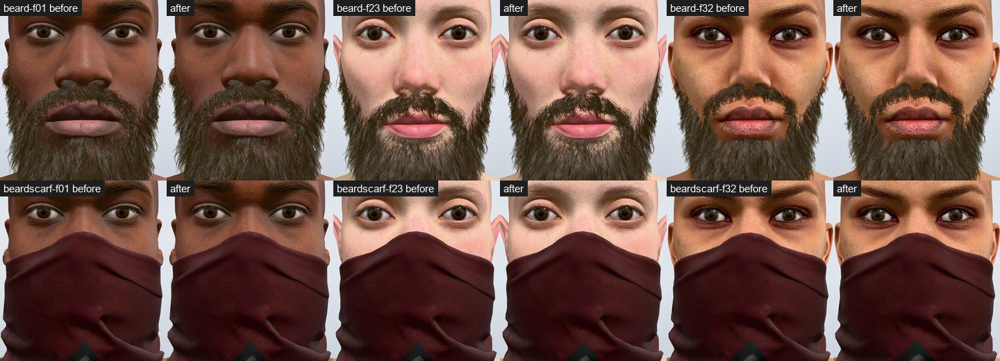

- **Changes in place** (`transitions.mjs`; the build store, as the item and body-type pickers use it), in one page:
  Face 32 3.74 mm → Face 01 0 → Face 32 3.74 → Androgynous 5.79 → Masculine 3.74 → balaclava off (no part) → on 3.74.
  The knit is closed after every change, and Face 01 is unpushed:

  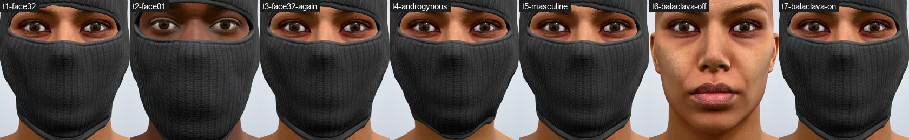

- **Cost and residue** (in the viewer, the push measured again after applying it): one rest-contact pass takes 8 to
  15 ms per part. It moves 5 of the knit's 1081 vertices on Face 23, 17 on Face 30, 58 on Face 32 (103 Androgynous)
  and 24 on Face 28. After the push no head vertex pokes through on Faces 01, 23, 30 or 32 (either body type). On
  Face 28, 2 do, at the brow (above). A change of face or body type re-measures it about 3 times (the fitting pass and
  the commit both refresh), 30 to 45 ms in all, beside a load that takes seconds.

- **Tests:** `tests/rig/face-animator.test.ts` adds a poking patch that is pushed to 0.5 mm inside. The same test
  covers a part clear of the face or 0.3 mm above it (no push), a lining corner or an inward-facing part (no hold) and
  hair cards (none). `tests/rig/head-wrap.test.ts` adds `overHead`: above the cage facing out is over the head; facing
  in, or below the cage, is not. `node --import tsx --test tests/rig/*.test.ts`: 500 pass, 4 skipped, 1 fails. The
  failure is `mesh-side.test.ts` needing an extracted ski-blade fixture this worktree does not have; it is unrelated.
  `tsc -b --noEmit` passes.

- **Functional checklist:** `functional-checklist.md`, agent run in `checklist-run.json` and `checklist-run.jpg`.

## Cage body-type morph gap (measured, no change)

PR #103 flagged that `head-wraps.json` publishes only the cages' fitting morphs (`FITTING_MORPH` in the untracked
`scripts/shader-probe/build-head-wraps.py`), while every face cage also carries the body-type morphs. Measured with
`cage-bodytype-gap.py` (game data only: the active `head-wraps.json`, the cage and part extractions under
`scripts/generated/shader-probe/`; output `cage-bodytype-gap.json`). It wraps each part with and without the cage's
`medium_male` on 26 faces (Faces 27, 28 and 31 have reordered cages and were not measured).

| Part | Max added move (Masculine) | Jaw band (y 1.62-1.66 m) | Neck band (y ≤ 1.62 m) | The part's own `medium_male` at that vertex (direction) | If the cage morph replaced the part's own |
| --- | --- | --- | --- | --- | --- |
| Balaclava | 7.1-10.6 mm | 5.2-7.1 mm | 3.8-4.9 mm | 6.6-11.6 mm (cos 0.97) | up to 8.3-9.5 mm different |
| Cowboy Mouth Scarf | 7.5-9.0 mm | 5.7-6.8 mm | 7.5-9.0 mm | 7.7 mm (cos 0.95-0.97) | up to 14 mm |
| Winter Mouth Scarf | 15.5-22.8 mm | 6.2-7.3 mm | 15.5-22.8 mm | 14.5-15.5 mm (cos 0.97-0.98) | up to 9-12 mm |
| Luchador Face Mask | 12.5-21.0 mm | 6.0-9.1 mm | 12.5-21.0 mm | 14.1-17.2 mm (cos 0.95-0.99) | up to 9-11 mm |
| Full Beard | 17.2-24.7 mm | 6.9-9.4 mm | 17.2-24.7 mm | 8.5 mm (cos 0.91-1.00) | up to 15-23 mm |

On Face 01, Masculine (left: as now; right: with the cage's `medium_male` added in the page). The balaclava's hem
drops and flares forward at the throat; the beard reaches further under the jaw. Both look plausible, so the picture
cannot say which is right:

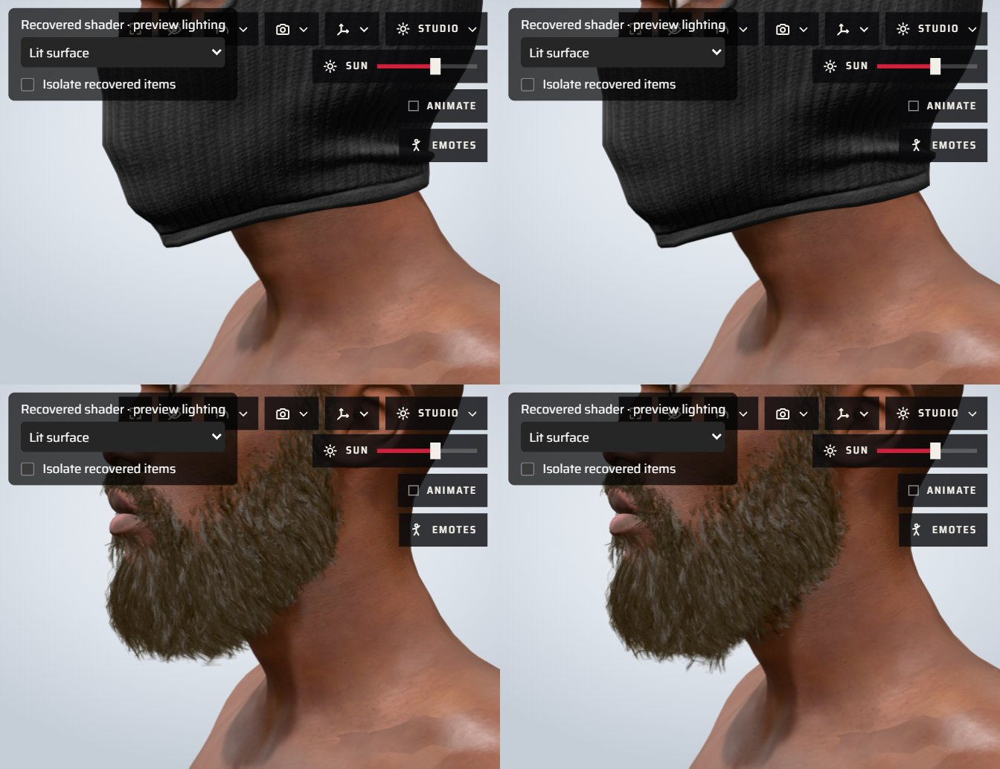

**Not a small, clearly correct fix, so no PR.** Adding the cage's `medium_male` would move the jaw and neck edge of
every one of these parts by 4 to 25 mm on Masculine. That is plainly visible. It moves them the same way as each
part's own `medium_male` morph, which the viewer already applies (`setBodyTypePreview`). For the balaclava, the
scarves and the mask the two are about the same size, so doing both would apply Masculine about twice. For the beard,
the cage moves its lower end about 3 times as far as the beard's own morph does. Which the engine does is not in the paks: the part's morph, the cage's, or both. Nor does the data say whether
its cloth deformer moves wrap-driven vertices by the part's morph at all (`bApplyAvaliableMorphTargetsAsDefault` on
the cloth config hints that it does). Settling it needs an in-game capture of a beard or scarf on a Masculine face. No
`head-wraps.json` was regenerated.

## Files

- `README.md`, `functional-checklist.md`: this record and the guided checks.
- `sweep.mjs`: idle captures of outfits on a dev server, with each head-wrapped part's push (fresh page per shot).
- `sweep2.mjs`: the same, putting each outfit on in place through the build store (one page per camera), which is
  much faster on a dev server.
- `transitions.mjs`: face, body-type and balaclava changes made in place, with the push after each.
- `make-sheets.py`: the contact sheets above, from `sweep*.mjs` output.
- `checklist-shots.json`, `checklist-run.json`: the agent run of the checklist.
- `cage-bodytype-gap.py`, `cage-bodytype-gap.json`: the cage body-type measurement.
- Images as linked above.
