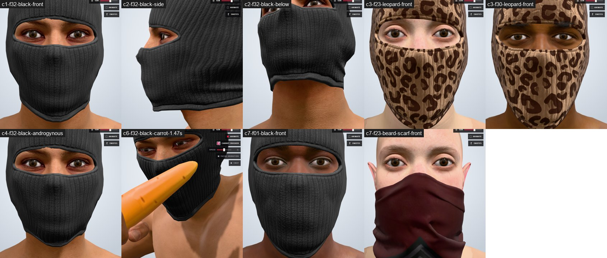

# Guided functional review: balaclava rest contact

## What you are checking

The face no longer comes through Balaclava Cotton Black and Balaclava Leopard at idle (Face 32's nose, lips, cheeks
and chin; the nose tip on Faces 23 and 30), and the knit re-fits when the face or body type changes. The checks catch
skin still showing, the knit moving where nothing poked, and a stale fit after a change.

- PR: this branch's PR (originating finding: PR #103, `_docs/balaclava-nose-2026-11-26/`)
- Test this revision: branch `claude/balaclava-rest-contact-2026-11-26`, at the PR's head commit
- Open: a dev server from this branch (below), in a desktop browser
- Prerequisites: Node and the repo's `node_modules`; `.env.local` with the `VITE_*` hosts from `.github/workflows/deploy.yml`
- Approximate hands-on time: 10 minutes
- Agent checks: see "Recorded result"
- User checks: waived by the owner for all PRs (22 Nov). The agent ran them; agent results do not tick the boxes.

## Get it running

```bash
# Git Bash, in this branch's checkout
npx vite --port 5217 --strictPort --host 127.0.0.1
```

The links below point at `http://127.0.0.1:5217/the-finals-outfit/`. `reconstructed=1` turns on the route the live site
draws (a dev server defaults to the other one). `view=` puts the camera about 40 cm from the face. Nothing is saved to
the site. Stop the server with Ctrl+C.

## Try it yourself

- [ ] **1. Start:** open
  [Face 32 + Cotton Black, front](http://127.0.0.1:5217/the-finals-outfit/?outfit=1.eyJzbG90cyI6eyJmYWNlIjoiaGVhZC1mYWNlLTMyLWJhc2UiLCJmYWNld2VhciI6InN0cmVldHdlYXItYmFsYWNsYXZhLWNvdHRvbi1ibGFjayJ9fQ&view=0_1.700_0.420_0_1.690_0&reconstructed=1).
  Expected: the viewer loads with no error. The knit is closed: no skin at the nose, nostrils, lips, cheeks or chin.
  (Main shows all of those through the knit.)
- [ ] **2. Other angles:** open the same from
  [the side](http://127.0.0.1:5217/the-finals-outfit/?outfit=1.eyJzbG90cyI6eyJmYWNlIjoiaGVhZC1mYWNlLTMyLWJhc2UiLCJmYWNld2VhciI6InN0cmVldHdlYXItYmFsYWNsYXZhLWNvdHRvbi1ibGFjayJ9fQ&view=0.400_1.700_0.160_0_1.690_0.050&reconstructed=1)
  and [from below](http://127.0.0.1:5217/the-finals-outfit/?outfit=1.eyJzbG90cyI6eyJmYWNlIjoiaGVhZC1mYWNlLTMyLWJhc2UiLCJmYWNld2VhciI6InN0cmVldHdlYXItYmFsYWNsYXZhLWNvdHRvbi1ibGFjayJ9fQ&view=0.080_1.520_0.380_0_1.650_0.050&reconstructed=1).
  Expected: the knit follows the profile, a little fuller over the nose and lips; no skin through it; the eye opening
  and the hem look as on main.
- [ ] **3. Leopard on Faces 23 and 30:** open
  [Face 23 + Leopard](http://127.0.0.1:5217/the-finals-outfit/?outfit=1.eyJzbG90cyI6eyJmYWNlIjoiaGVhZC1mYWNlLTIzLWJhc2UiLCJmYWNld2VhciI6InN0cmVldHdlYXItYmFsYWNsYXZhLWxlb3BhcmQifX0&view=0_1.700_0.420_0_1.690_0&reconstructed=1)
  and
  [Face 30 + Leopard](http://127.0.0.1:5217/the-finals-outfit/?outfit=1.eyJzbG90cyI6eyJmYWNlIjoiaGVhZC1mYWNlLTMwLWJhc2UiLCJmYWNld2VhciI6InN0cmVldHdlYXItYmFsYWNsYXZhLWxlb3BhcmQifX0&view=0_1.700_0.420_0_1.690_0&reconstructed=1).
  Expected: leopard spots on tan knit, and no nose-tip dot.
- [ ] **4. Androgynous:** open
  [Face 32 + Cotton Black, Androgynous](http://127.0.0.1:5217/the-finals-outfit/?look=2.nadia-leon--32gn.balaclava-cotton-black--6ag&bt=a&view=0_1.700_0.420_0_1.690_0&reconstructed=1).
  Expected: closed, including the jaw and chin (main shows a band of skin along the bottom of the knit there).
- [ ] **5. Changing the face and body type in place:** from step 1's page, open Items and pick Face 01, then Face 32
  again; then switch the body type to Androgynous and back to Masculine; then take the balaclava off and put it back.
  Expected: after each change the knit is closed on Face 32, and on Face 01 it looks as it does on main (no push there).
- [ ] **6. An emote with jaw movement:** open
  [Face 32 + Cotton Black, Carrot Crusher held at 1.47 s](http://127.0.0.1:5217/the-finals-outfit/?outfit=1.eyJzbG90cyI6eyJmYWNlIjoiaGVhZC1mYWNlLTMyLWJhc2UiLCJmYWNld2VhciI6InN0cmVldHdlYXItYmFsYWNsYXZhLWNvdHRvbi1ibGFjayJ9fQ&view=0.400_1.420_0.300_0.010_1.460_0.190&emote=rabbit-carrot&t=1.47&paused=1&reconstructed=1).
  This camera looks from the side the carrot leaves clear. Expected: paused at 1.47 s with the jaw open; the knit
  follows the jaw and stays over the mouth; no skin through it (main shows the nose tip and the lip).
- [ ] **7. Nearby face items:** open
  [Face 01 + Cotton Black](http://127.0.0.1:5217/the-finals-outfit/?outfit=1.eyJzbG90cyI6eyJmYWNlIjoiaGVhZC1mYWNlLTAxLWJhc2UiLCJmYWNld2VhciI6InN0cmVldHdlYXItYmFsYWNsYXZhLWNvdHRvbi1ibGFjayJ9fQ&view=0_1.700_0.420_0_1.690_0&reconstructed=1)
  and
  [Face 23 + Full Beard + Cowboy mouth scarf](http://127.0.0.1:5217/the-finals-outfit/?outfit=1.eyJzbG90cyI6eyJmYWNlIjoiaGVhZC1mYWNlLTIzLWJhc2UiLCJmYWNpYWxIYWlyIjoiZmFjaWFsaGFpcnMtYmVhcmRmdWxsLWJsYWNrIiwiZmFjZXdlYXIiOiJjb3dib3ktbW91dGhzY2FyZi1jb3R0b24tYmFuZGl0In19&view=0_1.700_0.420_0_1.690_0&reconstructed=1).
  Expected: both as on main. Face 01's knit is closed and unchanged (no push). The scarf sits as before and hides the
  beard, as on main.

If something fails, stop at that step and report its number and what happened. Reply "1-7 pass" (using the actual
step numbers), or for example "4 fails: skin shows along the chin".

## Recorded result

- Tested revision/build: this branch's head commit (code identical to the run), on a Vite dev server with the
  `deploy.yml` hosts, `reconstructed=1`; main's code (`842fa6d` + the PR #103 docs) on a second server for comparison.
- Agent run: 26 Nov 2026, headless Chrome at 1280×900. Every page reached `__rigIdle`, with no page or console errors
  (`checklist-run.json`, `checklist-run.jpg`).
  - Step 1 PASS: loads; closed (push 3.74 mm).
  - Step 2 PASS: side and below closed; the eye opening and hem as on main.
  - Step 3 PASS: leopard print; no nose-tip dot on Faces 23 (1.50 mm) and 30 (2.24 mm).
  - Step 4 PASS: Androgynous (`bt=a` read from the `look=` link; the legacy `outfit=` link ignores `bt`), closed,
    push 5.79 mm.
  - Step 5 PASS: the agent made the changes through the build store, which the pickers use (`transitions.mjs`):
    Face 32 3.74 → Face 01 0 → Face 32 3.74 → Androgynous 5.79 → Masculine 3.74 → off → on 3.74, closed each time
    (`transitions.jpg`).
  - Step 6 PASS: paused at 1.47 s (64/160), jaw open, knit closed over nose and mouth (`jaw-open-before-after.jpg`).
  - Step 7 PASS: Face 01 unchanged (push 0); the beard and scarf push 0 and match main to idle noise.
- User reported at: pending (checks waived for all PRs, 22 Nov).
- Readiness: agent PASS. Merge needs the owner's yes.


