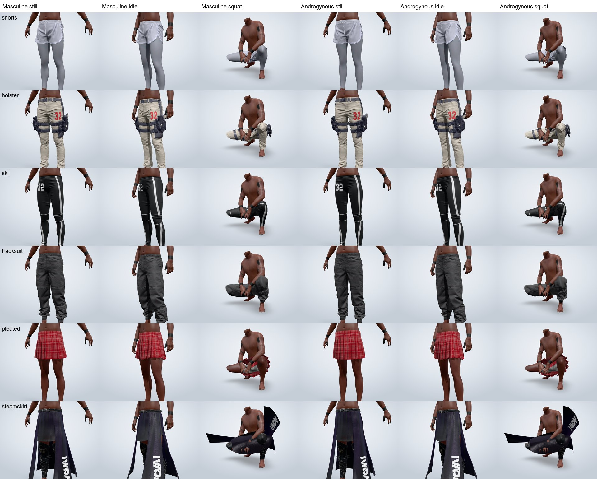
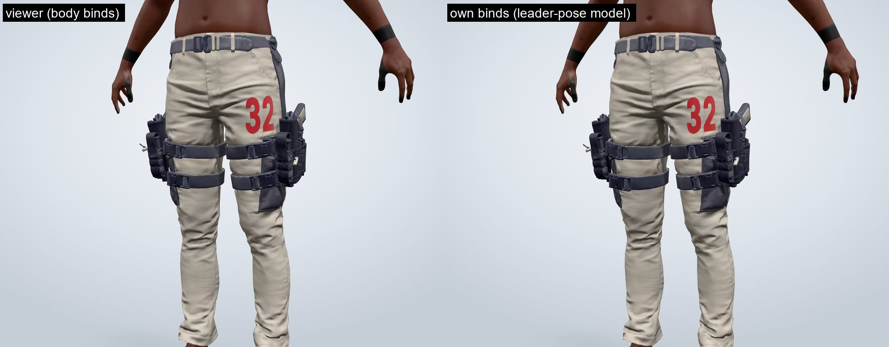
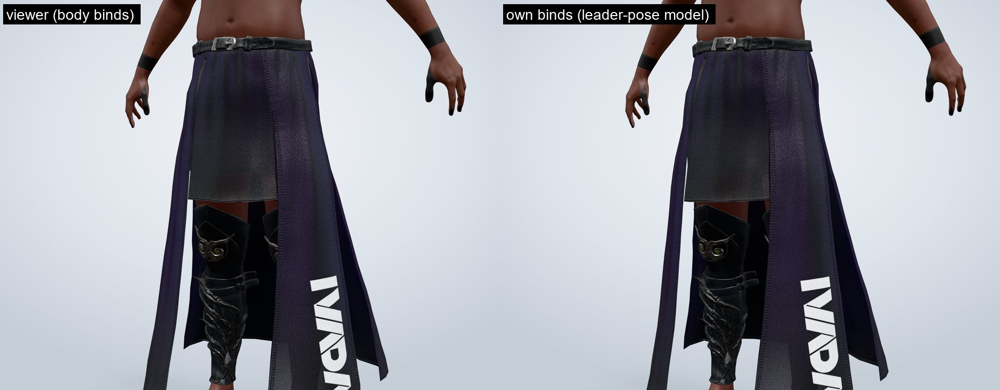
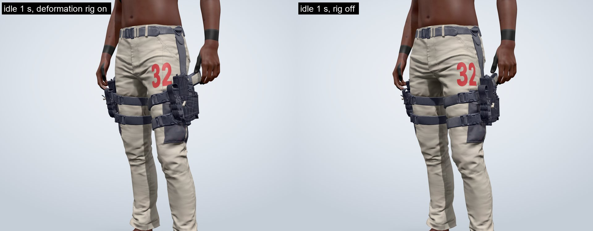
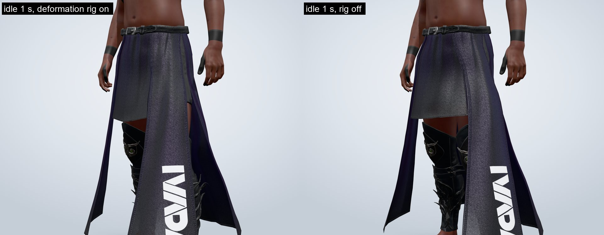
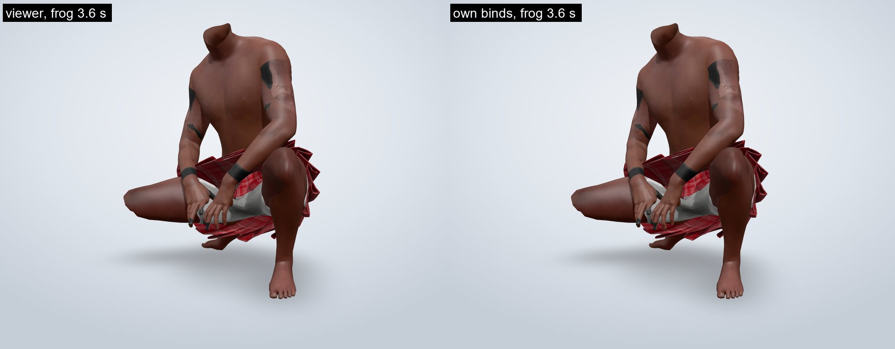
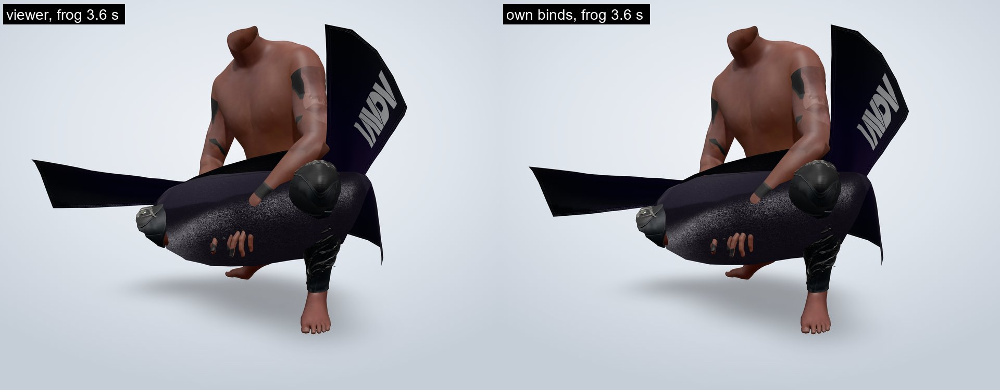

# thigh_roll_vpj bind offset (26 Nov 2026)

Follow-up to the S12 tier-2 C1 diagnostic (`vpj-binds.py` in the angry-darwin worktree): `thigh_roll_vpj_l/r` binds ~1 cm
/ ~4° away from the body's rest in live and S12 garments alike. Read-only investigation; no runtime code or
`public/models` change. Active index `reconstructed-assemblies-v1/assets.json` sha `e7cd0b2f…`. Captures were taken on
the live site, 26 Nov 22:38–22:55 UTC: the deploy of main 9aaccd7, bundle `index-CwjBMf9U.js`, the same app code as
f8ab09b.

## Answer

- **What it is.** Five leg helper joints sit at a different **roll about the bone's own long axis** in the garments'
  reference skeletons than in the body's. Joint positions agree to within 0.4 mm. It is a twist, not a shift: the
  "1 cm" in the first diagnostic is the bind-space origin swinging around the thigh axis, 14 cm away.
- **How widespread.** 644 of the 1,671 skinned meshes the index references put weight > 0.05 on an offset joint
  (404 Medium, 240 Light). That is every leg garment. 37 meshes agree with the body: the Medium and Light bodies
  themselves (the reference), plus nails, hair and beards, none of which weight the legs.
- **Root cause: game data, not our pipeline.** The body mesh, its USkeleton and the merge-target USkeleton all carry
  the newer roll; every garment carries the older one. FModel's raw `.uemodel` files from the June dump show the same
  numbers, decoded independently of our GLB converter. Garments were bound before a revision of the body's helper
  joints and were never re-imported.
- **The viewer ignores it, by design.** `rebindSourceSkeleton` (`src/rig/SourceSkeleton.ts`) gives every driver bone
  the driver's rest inverse and drops the garment's own inverse binds. Body and garment are skinned with one bind, as a
  merged UE mesh is. The offset cannot show in the viewer, and the captures confirm nothing at the thigh traces to it.
- **What the game does: most likely the same (a reasoned guess).** The character is one merged skeletal mesh
  (`MABP_CharacterMeshMerge`, `SK_CharacterMeshMergeTarget_*`). A stock UE merge builds one reference skeleton from the
  first source mesh and copies every vertex unchanged, so garments skin with the body's binds. A leader-pose follower
  would use its own binds instead and roll its leg vertices 4° about the thigh: median 8 mm, at most 36 mm on a leg
  garment.
- **Fix warranted: no.** Nothing to change in the viewer or the data. Not a reason to hold any S12 mesh either: live and
  S12 files carry the same offset, and the S12 proofs already ignore driver-bone inverse binds.
- **What does show on this joint is something else.** The ported deformation rig writes the left `thigh_roll_vpj`
  absolutely, as the cooked rig does. In idle it sits 32° from bind against 15° on the right. That turns the left
  holster into the hand and swings the Steampunk skirt's left panel forward. It is faithful to the rig program; not
  checked in-game.

## 1. How widespread

`scan.py` (output trimmed to `scan-summary.json`). For each skinned mesh in the index:

- the reference rest is the body the mesh was authored on: Medium (`attachmentBody.restBones`), Light (the Light body's
  inverse binds) or Heavy (Medium positions × 1.15), picked by median joint distance as `Archetype.ts sourceBindBasis`
  does;
- a joint counts as offset above 0.5° or 0.1 cm;
- "slide" is how far each vertex would move at rest if the mesh were skinned with its own inverse binds instead of the
  body's: |Σ w (rest·IBM − I) v|. "Normal" is the part of that along the vertex normal, the part that can open a gap or
  push into the body.

| Joint | Body local roll | Garment local roll | Offset (world) | Meshes with joint | Offset | Offset and weight > 0.05 |
|---|---|---|---|---|---|---|
| `thigh_roll_vpj_l` | 11.13° | 6.99° | **4.14°** | 744 | 707 | **607** |
| `thigh_roll_vpj_r` | 179.98° | 180.00° | **3.94°** | 737 | 700 | **579** |
| `thigh_volume_vpj_r` | 179.70° (under the roll joint) | 179.99° | **8.02°** | 432 | 395 | **297** |
| `knee_vpj_l` | 8.02° | 6.87° (= `calf_l`) | **4.12°** | 421 | 384 | **262** |
| `knee_vpj_r` | 8.02° | 6.87° | **4.12°** | 408 | 371 | **255** |
| `thigh_l` / `thigh_r` | | | 4.14° / 3.94° | ~1,000 | 14 / 11 | 4 / 4 (FromTencent items) |
| `thigh_volume_vpj_l` | 11.13° (under the roll joint) | 6.99° | cancels in world | 537 | 7 | 2 |
| `thigh_front_vpj`, `thigh_back_vpj` | | | ≤ 0.30° | ~800 each | 0 | 0 |

- **Joint positions** agree everywhere: the largest position difference on a weighted offset joint is 0.039 cm
  (0.4 mm).
- **Rotation axes.** `thigh_roll_vpj` rotates exactly about its own X (long) axis through the joint. `knee_vpj` rotates
  about the vertical through the knee.
- **Two one-offs, also weighted.** `SK_Military_DrifterCape_M` (cloth-sim batch) binds `head` 10.1° off, on 1,830
  vertices at weight 1. `SK_Streetwear_SkirtHipChain_M` binds `spine_01` 3.4° off, on 385 vertices. The viewer drops
  these binds too.
- **Unweighted noise.** Three hair meshes (`SK_Mohawk_M`, `SK_Mohawk_UnderHat_M`, `SK_HighPonytail_Tail_M`) carry
  flipped binds (90–180°) on arm and leg joints at zero weight. Harmless.
- **Slide if own binds were used** (644 weighted meshes, worst vertex per mesh): median 8.5 mm, p90 15 mm, max 37 mm
  (`SK_Military_DrifterCape_M`, mostly its 10° head). Along the normal: median 6 mm, p90 12 mm, max 35 mm.
  - Widest leg items: Steampunk skirt 36 mm (normal 23 mm), EasternDemon skirt (L) 36 mm, Knight skirt 34 mm,
    Samurai loose pants 25 mm.
  - Ordinary pants and shorts: 9–17 mm.
  - Tight geometry barely moves along its normal (BasicShorts: normal 4 mm), because a roll about the leg's own axis
    slides a near-cylinder around itself.

## 2. Where it comes from

`bodies.py` → `bodies.json` compares each joint's **local** rest (relative to its parent) across sources;
`uemodel-bones.py` reads FModel's raw `.uemodel` bones.

| Source | `thigh_roll_vpj_l` local roll | `knee_vpj_l` local roll |
|---|---|---|
| Body mesh `SK_Body_M` (our GLB): inverse binds and node rests | 11.132° | 8.024° |
| Legacy driver `models/body/SK_Body_M.glb` (what the viewer binds to) | 11.132° (Δ 0.02°) | 8.024° |
| `SK_Body_M_Skeleton` and `SK_CharacterMeshMergeTarget_Skeleton` (June dump, USkeleton ref pose) | 11.132° (Δ 0.02°) | 8.024° (body skeleton; the merge-target skeleton has no `knee_vpj`) |
| Light body `SK_Body_L` | 11.132° | 8.024° |
| LongCoat / DoubleHolsterPants (our GLBs: inverse binds and node rests agree) | 6.988° | 6.866° |
| LongCoat / DoubleHolsterPants, raw June `.uemodel` | 6.988° | 6.866° |

So the answer to "body rest or garment skeletons?" is the garments.

- Our rest (`attachmentBody.restBones`) is, by construction, the body mesh's own inverse binds
  (`build-assembly-assets.py`).
- The body mesh's bind, its USkeleton, the merge target's USkeleton and the legacy driver all agree.
- The garments' own reference skeletons disagree, identically in our GLBs and in the raw files, and identically in the
  June build, the live files and S12. Every leg garment has the old roll.
- The garments' `knee_vpj` matches `calf` exactly, which looks like the original setup. The body's was re-rolled by
  about 4°, together with `thigh_roll_vpj` and the right `thigh_volume_vpj`. *Guess:* a rig revision on the body
  skeleton after the garments were skinned.

### What UE would do with it

- **Each skeletal mesh skins with its own inverse binds**, computed from its own reference skeleton. The USkeleton's
  ref pose does not enter skinning.
- **Leader pose** (a follower component): the follower reads the leader's component-space bone transforms by name and
  multiplies them by its *own* inverse binds. A garment here would sit `bodyRest · garmentIBM` away from its authored
  shape at rest: the 4° roll and the slide in section 1.
- **Mesh merge** (what the character uses: `MABP_CharacterMeshMerge` drives `SK_CharacterMeshMergeTarget_Skeleton`,
  and the `Customization.Feature.MeshMergeModifiers` stack works on merge inputs):
  - `FSkeletalMeshMerge` builds **one** reference skeleton. Stock UE starts it from the first source mesh's and only
    adds bones later meshes bring.
  - It copies every source vertex unchanged and recomputes the inverse binds from the merged skeleton.
  - So a garment merged after the body is skinned with the **body's** binds, and its authored shape is kept exactly.
- *Guess, marked:* the merge behaviour is from the engine source as I know it; Embark's merge code is not in the files,
  and neither is its source order.
  - **For:** the merge-target skeleton carries the body's roll. The deformation Control Rig
    (`SK_CharacterMeshMergeTarget_CtrlRig`) is named after it.
  - **Against:** none found.
  - **Open:** `Avatar/MeshMerge/AttachmentVariations/TempUnmergable/` shows some parts run unmerged. A leader-pose
    part would use its own binds. Which items those are was not found.

### What the viewer does

- **Rebind.** `CharacterRig` rebinds every source skin through `rebindSourceSkeleton`. A driver bone gets the
  **driver's** rest inverse, and the mesh's own inverse bind is kept only for garment-only bones. So garment and body
  share one bind, the merged-mesh behaviour.
- **Driver vs body bind.** The legacy driver's bones differ from the body mesh's bind only by bone axes: positions
  agree to 0.001 cm, and the axis change cancels between pose and inverse.
- **In motion.** `DeformationRig.ts` (the ported Control Rig) poses `thigh_roll_vpj`, `knee_vpj` and the rest. Body and
  garment follow the same joint, so they cannot separate at the thigh. The left roll joint's 11° jump from bind when an
  animation starts is the game rig's own (showcase-animation README).
- **Other paths.**
  - Export 3D writes the rebound skeleton, so it matches the viewer.
  - The S12 proofs (`skin-by-name-proof.py`) compare inverse binds of extension bones only, which is consistent.
  - On Light and Heavy, `sourceBindBasis` uses the median joint distance, which a few helper joints cannot move.

## 3. Does it show

`capture.mjs` drives the live site in headless Chrome with `capture-plan.json`:

- **Links.** `#/?o=…&bt=…&view=…&emote=…&t=…&paused=1`, plus `?reconstructed=1`. Overlays are hidden (H). Canvas at
  1.5× scale.
- **Items.** BasicShorts, DoubleHolsterPants, SkiPants, TrackSuitPants, PleatedSkirt, and the Steampunk skirt (the
  widest).
- **Grid.** Masculine and Androgynous × still, idle (`outfit-idle` at 1 s) and a deep squat (Lily Leaper `frog` at
  3.6 s).
- **Own-bind pairs.** On Masculine, each still, and the squats of the two skirts and the holster pants, is captured
  again after replacing the garment's offset-joint inverses in the page with its own binds (`ownbind-offsets.json`).
  That shows what a leader-pose game would draw. Page state only.

**What was checked.**

- **Read at full size (1920×1500):**
  - every Masculine still and squat;
  - the holster and Steampunk idles;
  - all nine own-bind pairs;
  - the Androgynous holster still, idle and squat, the shorts squat, the pleated still and the tracksuit idle.
- **The other Androgynous frames** were compared against the contact sheet and match their Masculine counterparts.



**The bind offset does not show.**

- **The viewer cannot show it.** No garment inverse bind on a driver bone is used, so nothing at the thigh can come
  from it.
- **The own-bind pairs show what a leader-pose game would draw.** Garments roll a few degrees about each thigh:
  - DoubleHolsterPants: the holsters and the "32" decal swing about 1 cm;
  - Steampunk skirt: its long panels swing about 3 cm;
  - SkiPants: its side stripe shifts a few mm.
- **Neither version opens a gap or clips** in the still pose, and in the squat both look the same.




**What does show at the thigh, with other causes** (the same in both binds and on both body types):

- **The left `thigh_roll_vpj` jump in animation.** This is the largest thigh effect in these captures, and it involves
  the same joint, though not this offset.
  - **Measured.** In `outfit-idle` at 1 s, the ported rig holds the left joint **32.4°** from its bind and the right
    **15.2°** (`deform-log.json`).
  - **Why.** The cooked rig sets the left joint's local rotation **absolutely**. Instruction 223 writes the roll with no
    initial rotation. The right side multiplies its initial rotation in (249–263). The body binds the left joint at a
    rolled 11.1°, so the left side lands about 11° further from its bind. The disassembly is in the showcase evidence
    folder, `scripts/generated/anim-export/research/ctrlrig-disasm.txt`, and the showcase README already notes this
    11° slip.
  - **Visible.** In idle the left holster turns forward and the left hand sinks into the gun grip. The Steampunk
    skirt's long left panel swings in front of the leg. With the rig off (`__rigAnim.deform(false)`), both stay at the
    side as in the still pose.
  - **The game.** The port matches the cooked program, so the game should show the same, given body binds. Not checked
    in-game.

  
  

- **Skirts in the deep squat** (Lily Leaper at 3.6 s):
  - the raised thigh passes through the front of the pleated skirt;
  - the Steampunk skirt balloons around the thighs, swallows the hands, and its side panels stick out like wings.
  - This is skinning alone on long cloth. The game runs outfit-screen cloth physics (`MABP_CharacterMeshMerge_Physics`)
    that the viewer doesn't. *Guess:* the game's skirts move away here.

  
  

- **Knees in the deep squat:**
  - a faceted lump on the bent knee of the pants (low-poly geometry pushed by `knee_vpj` volume);
  - a dark shadow patch on the shorts' tights;
  - the shorts' hem flaring off the thigh.
  - `thigh_front_vpj_l` reaches 90.5° there, through the approximated `EmbarkSphericalAim`. The Embark unit has no
    source, so the front-thigh shape in deep squats is the least certain part of the port.

**Verdict:** the 4° bind offset is invisible in the viewer and would be cm-scale and plausible-looking even if the game
used own binds. Nothing to fix. The thigh effects worth knowing are the rig's left-roll jump (a faithful port, not
checked in-game) and missing cloth physics on skirts.

## Files

- `glbskin.py`: minimal GLB skin reader.
- `scan.py` → `scan-summary.json` (trimmed): question 1.
- `bodies.py` → `bodies.json`, and `uemodel-bones.py`: question 2.
- `ownbind-offsets.py` → `ownbind-offsets.json`, `capture.mjs`, `capture-plan.json` (→ `capture-log.json`) and
  `deform-plan.json` (→ `deform-log.json`, with the helper-joint angles): question 3.
- `captures/`: the images cited above, as JPEG (pairs at half size and a contact sheet). The 45 full-size PNGs were
  judged locally and are not committed; rerun `capture.mjs` to get them back.

Rerun from the worktree root (read-only on every input):

```
python -X utf8 -I _docs/thigh-roll-vpj-2026-11/scan.py OUT.json
python -X utf8 -I _docs/thigh-roll-vpj-2026-11/bodies.py OUT.json
node _docs/thigh-roll-vpj-2026-11/capture.mjs OUT_DIR _docs/thigh-roll-vpj-2026-11/capture-plan.json
```
